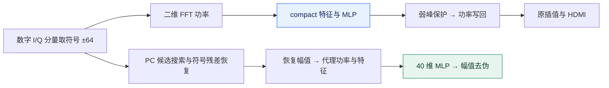
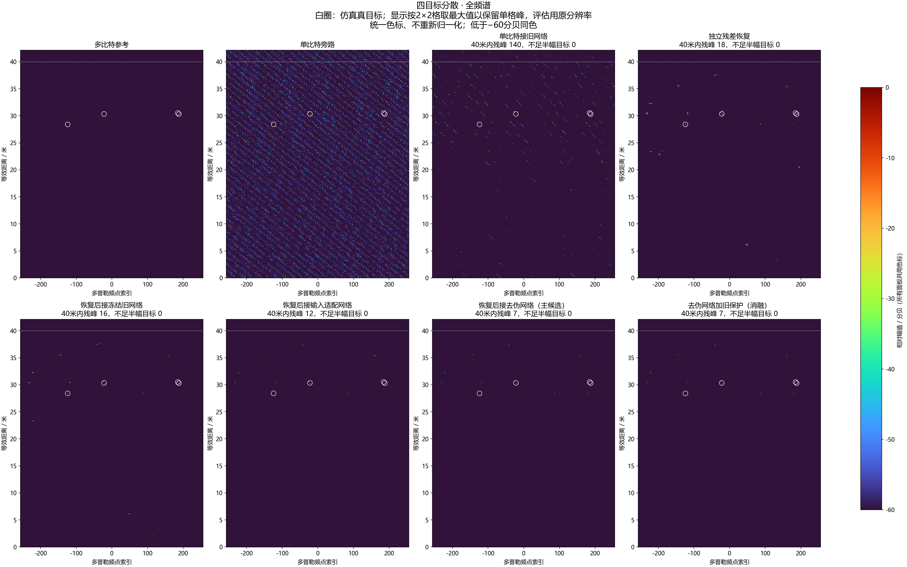

<div align="center">

# 轻量单比特雷达恢复

**compact FPGA 实验部署 · PC 符号恢复与后级去伪**

40 → 32 → 16 → 1 MLP · 1857 参数 · ZU4EV / PC 双路径归档

[选择版本](docs/GETTING_STARTED.md) · [模型与数据](docs/METHOD_AND_DATA.md) · [结果与证据](docs/RESULTS.md) · [下载运行包与数据](https://github.com/ysy813/onebit-radar-recovery/releases/tag/archive-2026-11-13)

</div>

---

本项目研究如何在 I/Q 符号量化后，减少雷达频谱中的谐波、互调与参考外残留，同时记录对真实目标的影响。仓库保存了**已有 FPGA 实验版本**和**最新 PC 去伪研究版本**的代码、冻结权重、验证结果与配套数据。

## 两条路径，分别使用

| | compact 硬件实验版 | 最新 PC 去伪研究版 |
|---|---|---|
| 处理方式 | 单比特 FFT 功率 → 标量增益与弱峰保护 | 符号残差恢复 → 后级 40 维去伪网络 |
| 网络计算 | Q16 内部计算，Q14 幅值增益 | PC 浮点，增益范围 1/64–1.5 |
| 当前入口 | [硬件与 SD 修复](docs/GETTING_STARTED.md#硬件实验版) | [PC 使用与数据](docs/GETTING_STARTED.md#pc-研究版) |
| 已有结果 | 构建及数值验证；保存了网络＋SD 短测日志 | 12 帧最终测试通过本轮去伪优先研究判据 |
| 关键限制 | 历史整体质量 FAIL；非完整时序签核 | 弱目标损失明显；CPU 前端未部署到 PL |

两条路径的输入、增益下限、保护与数值规则不同，**PC 新权重不能直接替换硬件版权重**。

## 处理流程



原始 I/Q 的 SD 存储支路独立于图中的网络处理。前级成像与存储系统见[配套 FPGA 仓库](https://github.com/ysy813/fpga-radar-imaging-sd)。

## 最新 PC 结果

以下为同一组 **12 帧、40 米内 46 个已知仿真目标**的结果。“主要目标”按多比特参考峰相对幅值 ≥0.25 划分；“不足半幅”是输出低于参考的一半，不等同于实际检测漏警。

| 方法 | 参考外残峰 / 帧 ↓ | 最强参考外幅值 ↓ | 主要目标不足半幅 | 弱目标不足半幅 |
|---|---:|---:|---:|---:|
| 单比特接旧网络 | 101.00 | 0.3288 | 0 / 32 | 0 / 14 |
| 独立残差恢复 | 8.92 | 0.6823 | 0 / 32 | 3 / 14 |
| 恢复后接输入适配网络 | 2.67 | 0.3614 | 0 / 32 | 13 / 14 |
| **恢复后接去伪网络** | **1.17** | **0.3142** | **0 / 32** | **12 / 14** |

主候选相对独立恢复的残峰数减少 **86.92%**，同时新增 **9 个弱目标半幅失败**。这是当前去伪优先设置下的明确取舍；参考外峰指标不是 CFAR 虚警率，尚有强伪峰未被压制。[完整口径、简单阈值对照与失败案例 →](docs/RESULTS.md)

<details>
<summary><strong>查看真实同帧对照：四目标分散场景</strong></summary>



这是一帧仍有明显残留的例子：独立恢复 18 个参考外峰，主候选 7 个；最强残留幅值约 0.3142。白圈只标注仿真真值，不参与推理。各面板共用色标，展示采用 2×2 格最大值聚合，指标使用原分辨率。

[打开原图](pc/scalar_postrestore_suppress_v1/results/test_002_n4_spread.png) · [全部 12 帧中文对照](pc/scalar_postrestore_suppress_v1/results/index.html)（HTML 请下载后在浏览器打开）

</details>

## 硬件版已保存的板测证据

compact SD 修复版的[串口日志](hardware/radar1_scalar_compact_sd_fix_v1/board_runs/log.txt)记录：

| 项目 | 记录 |
|---|---|
| 原始存储 | 60 块，共 120 MiB；读回 PASS，`acquisition_error=0` |
| 网络处理 | `done=6`，`fault=0` |
| 调度与耗时 | `image_skip=54`，`infer_ms=3888` |

它证明这次记录中的网络运行和存储结果，不能据此称为无跳帧、实时处理或质量验收通过。[查看构建、板测与质量状态的区别 →](docs/RESULTS.md#硬件实验版的证据)

## 代码、权重、数据在哪里

| 内容 | 入口 |
|---|---|
| compact PC 定点模型与保护 | [pc_candidate_compact](pc/scalar_restore_v3/pc_candidate_compact/) |
| compact FPGA 工程 | [radar1_scalar_compact_exp_v1](hardware/radar1_scalar_compact_exp_v1/) |
| 最新 SD 软件修复 | [radar1_scalar_compact_sd_fix_v1](hardware/radar1_scalar_compact_sd_fix_v1/) |
| 最新 PC 主候选权重 | [candidate/suppress/model_float.pt](pc/scalar_postrestore_suppress_v1/candidate/suppress/model_float.pt) |
| 便携后级推理 | [tools 使用说明](tools/README.md) |
| 68 帧划分、种子与来源 | [数据说明](docs/METHOD_AND_DATA.md)、[相对路径清单](manifests/DATA_CATALOG.json) |
| 运行包与完整数值数据 | **[Release 附件](https://github.com/ysy813/onebit-radar-recovery/releases/tag/archive-2026-11-13)** |

查看代码和图片只需源码仓库；复查完整数组再下载约 1.29 GiB 的研究数据包。所有附件均解压到仓库根目录，具体见[下载与使用指南](docs/GETTING_STARTED.md)。

<details>
<summary><strong>展开仓库结构</strong></summary>

```text
├─ hardware/                    compact FPGA 工程与 SD 修复
├─ pc/
│  ├─ scalar_restore_v3/         compact PC 模型与历史结果
│  ├─ scalar_postrestore_suppress_v1/ 最新后级去伪研究
│  └─ …                        前端、旧40维模型与数据来源依赖
├─ tools/                       便携后级推理入口
├─ docs/                        使用、方法、结果与网络学习资料
└─ manifests/                   来源、散列、数据目录和校验结果
```

`scalar_multipeak48_v1` 在此作为旧 **40 维**权重、特征和仿真依赖保留，目录名不表示采用了 48 维主候选。未收录 CDQOB RGB 整网工程。

</details>

---

**阅读与溯源**　[compact 学习资料](docs/network_understanding_v1/00_阅读入口.md) · [文件来源](manifests/SOURCE_MANIFEST.json) · [资产与 SHA256](manifests/RELEASE_ASSETS.json) · [文档更新记录](docs/CHANGELOG.md)

当前模型不恢复复数相位；现有 PC 图是频谱研究结果，不代表新增物理 SAR 聚焦验收。厂商与第三方文件保留原版权声明，当前未为整仓指定统一开源许可证。
